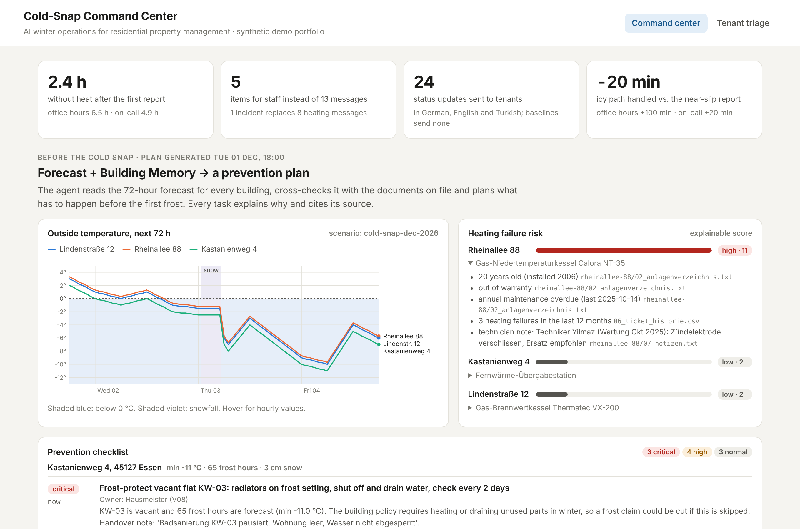
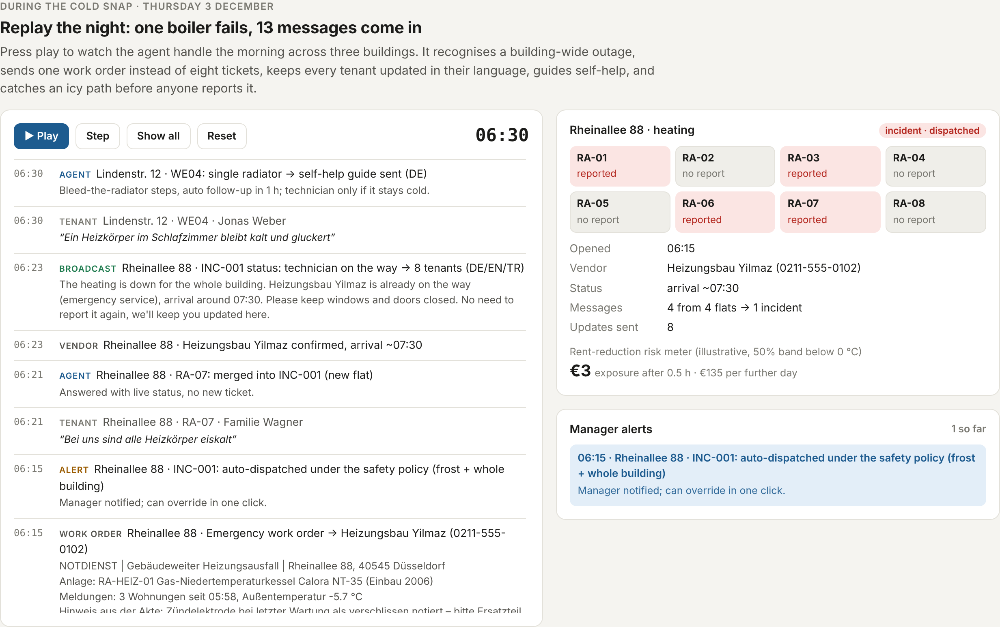

# Cold-Snap Command Center

**AI winter operations for residential property management.** One agent watches a portfolio of buildings before and during a cold snap. It plans prevention from the forecast and the building's own documents. During the night it turns a flood of tenant messages into one incident, one work order and live updates for every tenant in their language.

> All data is synthetic: three fictional buildings in Düsseldorf and Essen, fictional tenants, firms and policies. No real personal data is used.



## The problem

Winter is when residential property management is under the most pressure:

- **Heating failures come as a flood.** When one boiler fails, every flat reports it separately: 8 tickets, 8 calls, no overview. Courts expect about 20–22 °C during the day, and common guidance allows rent reductions of 30–50 % for a multi-day failure and up to 100 % for a total failure in the cold season.
- **Clearing snow and ice is the owner's liability.** It can be delegated to tenants only through an explicit lease clause, and the owner still has to check that it was done. A notice in the hallway is not enough.
- **Frozen pipes in vacant flats.** Building insurance usually requires unused parts of a building to be heated or drained in winter, so a frost claim can be cut if that wasn't done.
- **Many "heating" tickets aren't faults.** One cold, gurgling radiator usually just needs bleeding, but it still costs a technician visit.

## What the agent does

**Before the cold snap** (Tue 18:00, 72 h forecast):

| | |
|---|---|
| Heating risk score | Ranks every central heating system with an explainable score: age, warranty, overdue maintenance, failures in the last 12 months, technician notes. *Rheinallee 88's 20-year-old boiler scores 11/high, partly because a technician noted a worn ignition electrode.* |
| Prevention checklist | Frost-protect vacant flat KW-03 (citing the policy's duty to heat or drain), drain outdoor taps, alert the winter service, **flag a building with no valid winter-service contract**, and arrange a pre-frost check plus 24/7 standby for the riskiest boiler. Each task has an owner, a due time, a reason and source documents. |
| Tenant broadcast | Winter tips for all 19 tenants in German, English or Turkish. |

**During the cold snap** (Thu 3 Dec, boiler fails at 04:50):

| Capability | What happens in the replay |
|---|---|
| **Incident detection** | Once 3 flats report heating within 2 h, the reports merge into one building-wide incident. Later reports are answered with live status instead of creating new tickets. |
| **Context in the work order** | The emergency work order tells the technician to *bring a spare ignition electrode*, from the Oct 2025 maintenance note. This alone saves about 2.5 hours. |
| **Live tenant updates** | 3 broadcasts × 8 tenants (on the way → on site → fixed), each in the tenant's language. |
| **Vulnerable households** | "…we have a baby" → offer a temporary heater and alert the manager. |
| **Self-help** | "One radiator is cold and gurgles" → a bleeding guide and a 1-hour follow-up. The tenant replies "worked", so no technician visit is needed. |
| **Winter-service proof** | On snow and ice days every building needs a photo check-in by 07:00 (Sundays 09:00). Kastanienweg has no contractor, so at 07:00 the agent orders one ad hoc, **20 minutes before a tenant reports nearly slipping**. |
| **Rent-risk meter** | Hours without heat × warm rent × guidance band → € exposure. Long outages in frost trigger heater offers. |
| **Everything else** | Goes to the context-aware triage agent (v1): who pays, which firm, recurring failures. *For example, the 3rd lukewarm-water complaint in 90 days flags the circulation pump for replacement.* |

Safety-critical actions (building-wide heating loss in frost, ice on paths) are dispatched immediately and the manager is notified. Everything else waits for one-click approval.



## Results (simulated night)

The same 13 tenant messages, the same boiler failure and the same technician speed in every column. Only the operating model changes.

| Metric | Agent | Office hours | Night on-call |
|---|---|---|---|
| Items staff must read and handle | **5** | 13 | 13 |
| Technician dispatched after 1st report | **+17 min** | +128 min | +20 min |
| Worn part brought along | **yes** | no | no |
| Heating restored | **08:20** | 12:26 | 10:53 |
| Hours without heat (after 1st report) | **2.4** | 6.5 | 4.9 |
| Flat-hours in the cold | **19** | 52 | 39 |
| Proactive status updates to tenants | **24** | 0 | 0 |
| Technician visits for a radiator that just needed bleeding | **0** | 1 | 1 |
| Icy path handled, relative to the near-slip report | **−20 min** | +100 min | +20 min |

Read this honestly. Against a night on-call person, the agent dispatches at about the same time; most of its speed comes from **the context it puts in the work order**. Its other gains are staff load, tenant communication and catching the icy path before anyone reports it. All assumptions are in [`data/scenarios/cold-snap-dec-2026/events.json`](data/scenarios/cold-snap-dec-2026/events.json), and you can change them and re-run.

The prevention plan had already told the manager to replace the worn part two days earlier. The replay assumes nobody acted on it, so you can see the incident flow too.

**Tenant triage (v1)** on 63 labelled messages (DE/EN/TR): with the Building Memory, the agent decides who pays correctly 90 % of the time on a held-out set (first run), against 50 % without context. See [`eval/`](eval/).

## Run it in VS Code

**Requirements:** Python 3.10+ and VS Code with the Python extension. You need no API key and no internet.

1. Clone the repository and open the folder in VS Code (*File → Open Folder*).
2. Open a terminal (*Terminal → New Terminal*) and create a virtual environment:

   **Windows (PowerShell)**
   ```powershell
   py -m venv .venv
   .venv\Scripts\Activate.ps1
   pip install -r requirements.txt
   ```
   If PowerShell blocks the activate script, run `Set-ExecutionPolicy -Scope CurrentUser RemoteSigned` once.

   **macOS / Linux**
   ```bash
   python3 -m venv .venv
   source .venv/bin/activate
   pip install -r requirements.txt
   ```
3. Choose the interpreter: `Ctrl+Shift+P` → *Python: Select Interpreter* → `.venv`.
4. Open the **Run and Debug** panel (`Ctrl+Shift+D`) and choose a configuration:
   - **1. Run web app**: then open http://localhost:8000
   - **2. Cold-night simulation**: prints the comparison and the full timeline in the terminal
   - **3. Build Building Memory**: ingests all documents and lists the gaps it found
   - **4. Triage eval**: accuracy of the v1 agent
5. Tests: open the **Testing** panel (flask icon) and press *Run All*, or run `python -m pytest -q` (18 tests).

From a plain terminal instead: `uvicorn app.api:app --reload`, `python -m app.simulate --timeline`, `python -m pytest -q`.

**Live weather:** `GET /api/forecast?source=live` uses the free Open-Meteo API for each building's coordinates and falls back to the scenario if you're offline.
**Optional LLM:** set `USE_LLM=1` and `ANTHROPIC_API_KEY` to let an LLM do the message-understanding step. Its output is schema-validated, with a fallback to the rules. All decisions stay in deterministic, auditable code.

## Architecture

```
data/<building>/*.txt|csv  ─┐   messy documents: stammdaten, assets, leases (rent, clauses),
data/shared/vendors.txt    ─┤   insurance (perils, duties), ticket history, handover notes
                            ▼
app/ingest.py      Building Memory: knowledge graph, every fact with its source + gap detection
app/weather.py     72 h forecast (scenario or Open-Meteo) → frost / hard frost / snow / ice days
                            ▼
app/prevention.py  BEFORE: heating risk score, checklist (vacant flats, taps, winter service,
                   boiler standby), multilingual tenant tips
app/command_center.py  DURING: event loop over tenant messages, vendor updates, check-ins and the clock
                   → incidents, self-help, winter-service deadlines, rent-risk meter, alerts
app/agent.py       v1 triage for everything else: who pays, which firm, recurring failures
app/simulate.py    replays the night against two baselines with the same technician model
app/api.py + ui/   FastAPI + one-page UI (forecast chart, checklist, replay, comparison, triage)
```

API docs: http://localhost:8000/docs (`/api/forecast`, `/api/prevention`, `/api/simulation`, `/api/triage`, `/api/portfolio`).

## Production path

- **Real inputs:** WhatsApp, e-mail and voice transcripts into `CommandCenter.on_tenant`; vendor updates from an app or SMS reply; check-ins with GPS and a photo.
- **Real documents:** OCR plus LLM extraction into the same field schema, with confidence scores and human review for low-confidence fields.
- **Smart meters / IoT:** where available, boiler fault codes or flow temperatures open an incident *before* the first tenant feels cold.
- **Learning loop:** every manager override becomes an eval case, and incident thresholds get tuned per building.

## Limits

This is a demo on synthetic data. The legal points (heating expectations, rent-reduction bands, clearing duty, insurance duties) are simplified from common German guidance and are **not legal advice**. The baseline timings are assumptions, stated in the scenario file.

---
Built by **Guru Prasad Vastrala**, M.Sc. Data & Knowledge Engineering, OVGU Magdeburg.
